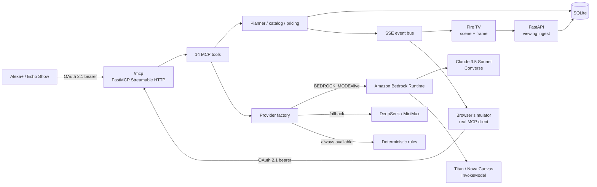
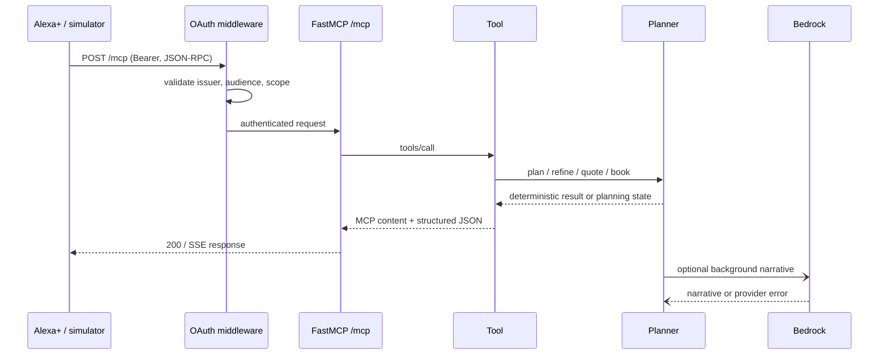

# AWS Architectural Blueprint

**Project:** ScreenToStream Concierge  
**Track:** Alexa+ MCP + AWS Builder Mini Challenge  
**Status:** Bedrock adapter implemented and unit-tested with a mocked Bedrock Runtime; live AWS validation requires credentials and model access in the judging account.

**Companion documents:** [Submission checklist](SUBMISSION_CHECKLIST.md) · [AWS account setup guide](AWS_ACCOUNT_SETUP.md) · [Bedrock operator guide](AWS_BEDROCK.md) · [Open Source Friction Log](FRICTION_LOG.md) · [Alexa+ integration guide](ALEXA_PLUS.md) · [Docker verification log](DOCKER_VERIFICATION.md)

---

## 1. Executive summary

ScreenToStream Concierge turns the Fire TV moment a guest is watching into a
bookable travel and culinary plan. Alexa+ reaches the service through a
self-hosted, OAuth-protected MCP server. The AWS integration is intentionally
placed **behind the provider adapter layer**, not in the MCP transport.

The design has three properties that matter for judging:

1. **Protocol integrity.** The only MCP entry point is the flat
   `/mcp` Streamable HTTP endpoint. JSON-RPC, `initialize`, session state,
   OAuth, and all 14 tools stay untouched.
2. **AWS-native AI.** Amazon Bedrock Runtime supplies reasoning, structured
   intent extraction, multimodal frame understanding, editorial card copy, and
   generated hero imagery.
3. **Graceful degradation.** Every Bedrock call has a deterministic fallback.
   The demo, tests, and booking flow still work without AWS credentials.

---

## 2. AWS integration at a glance

| Capability | AWS service / API | Model | Fallback |
|---|---|---|---|
| Structured intent | Bedrock Runtime Converse | Claude 3.5 Sonnet | Deterministic rules parser |
| Narrative / refinement | Bedrock Runtime Converse | Claude 3.5 Sonnet | Curated catalog copy |
| Simulator tool loop | Bedrock Runtime Converse tool use | Claude 3.5 Sonnet | Deterministic rules router |
| Frame understanding | Bedrock Runtime Converse image block | Claude 3.5 Sonnet | Scene matcher + prompt hints |
| Card copy | Bedrock Runtime Converse | Claude 3.5 Sonnet | Deterministic visual card |
| Hero artwork | Bedrock Runtime InvokeModel | Titan Image Generator / Nova Canvas | Existing SVG destination art |

The integration is implemented in:

- `app/aws_bedrock.py` — Bedrock Runtime adapter, message/tool translation,
  image blocks, image generation, caching.
- `app/providers.py` — provider factory; Bedrock wins when enabled, then
  DeepSeek/MiniMax, then deterministic rules.
- `app/config.py` — `BEDROCK_MODE`, region, model IDs, image dimensions.
- `app/planner.py`, `app/simulator.py`, `app/synthesis.py` — unchanged call
  sites through the shared provider interface.

---

## 3. System context



---

## 4. Request flows

### 4.1 MCP tool call



Key rule: Bedrock is never on the synchronous critical path for
catalog/pricing/quote/book operations. Those are local SQLite and Python
operations. Narrative and art are background work.

### 4.2 Plan with Bedrock narrative

1. `plan_trip` normalizes the request and writes the trip row.
2. The catalog selection and price calculation complete locally.
3. A deterministic base plan is stored immediately.
4. If Bedrock is enabled, a background task calls Converse with the narrative
   prompt and merges the result into the cached plan.
5. `get_trip` returns the updated plan; the simulator receives the card over
   MCP and the SSE `trip_ready` event.

### 4.3 Frame understanding

1. `POST /api/viewing/frame` validates size and reads PNG/JPEG/WebP/GIF
   metadata without Pillow.
2. The frame is converted to a data URL and passed to the provider.
3. Bedrock receives a Converse message containing:
   - the prompt with the candidate scene catalog and image metadata;
   - an image block with the raw bytes and correct format.
4. The JSON response is validated/normalized and matched to a scene.
5. On any Bedrock failure, the deterministic scene matcher runs.

### 4.4 Visual card

1. The plan already contains a deterministic visual card.
2. If Bedrock is enabled, background synthesis asks Converse for editorial
   copy and an image prompt.
3. `InvokeModel` generates a hero image; the result is cached under
   `runtime/generated/` and served from `/media/generated/...`.
4. The plan is updated and `trip_card_ready` / `tv_card` events are published.
5. If generation fails, the existing deterministic card remains valid.

---

## 5. Provider selection and fallback matrix

```text
LLM_MODE=mock  ──────────────────────────────▶ rules
BEDROCK_MODE=off + DeepSeek/MiniMax key ─────▶ DeepSeek / MiniMax
BEDROCK_MODE=auto + credential markers ──────▶ Bedrock
BEDROCK_MODE=live ────────────────────────────▶ Bedrock
No provider configured ───────────────────────▶ rules
```

| Situation | Behavior |
|---|---|
| Bedrock success | Provider metadata records `bedrock`, region, model, latency |
| Bedrock timeout/error | `ProviderError`; caller uses deterministic fallback |
| Bedrock image failure | Card keeps deterministic hero; no user-visible failure |
| DeepSeek/MiniMax failure | Same fallback path when `BEDROCK_MODE=off` |
| `LLM_MODE=mock` | All external providers disabled for tests/CI |
| Missing credentials | Auto mode stays off; rules path is used |

Provider usage is written to the `usage` table and exposed at `/api/usage`.
Effective provider selection is exposed at `/api/simulator/status`.

---

## 6. Security architecture

### 6.1 OAuth and MCP

- OAuth 2.1 authorization code + PKCE S256.
- Protected Resource Metadata and Authorization Server Metadata.
- `resource` audience is exactly `PUBLIC_BASE_URL + /mcp`.
- Unauthenticated `/mcp` returns `401` **without** `WWW-Authenticate`, matching
  the Alexa+ contract.
- Tool-level scopes:
  - `concierge.read` for planning and reading;
  - `concierge.book` for quote/booking;
  - `profile.read` / `profile.write` for preferences.
- Tokens are validated for issuer, audience, expiry, and type.

### 6.2 AWS credentials

The adapter uses the standard `boto3` credential chain. No AWS secret is
stored in source or returned by the API.

Recommended production identity:

- ECS task role or EC2 instance profile;
- least-privilege `bedrock:Converse` and `bedrock:InvokeModel`;
- model access enabled in the target region;
- `BEDROCK_MODE=live` when using a role that auto mode cannot detect.

### 6.3 Data handling

- Frame bytes are sent to Bedrock only for vision requests.
- Generated imagery is cached locally under `runtime/generated/`.
- The app does not log raw image bytes or bearer tokens.
- Provider error text is truncated before storage.
- SQLite stores simulated bookings only; there are no real payments or
  inventory holds.

---

## 7. Performance design

| Path | Design | Target |
|---|---|---|
| MCP `initialize` | local negotiation | < 500 ms |
| `get_viewing_context` | SQLite + catalog | < 500 ms |
| `plan_trip` | deterministic selection + cache | < 500 ms when ready |
| Bedrock narrative | background task | not on hot path |
| Bedrock image | background task + cache | not on hot path |
| Frame vision | provider call | fallback budget enforced by caller |

Additional controls:

- Speculative plan cache keyed by scene + intent parameters.
- `/media/generated` digest cache prevents repeated image generation.
- `asyncio.to_thread` keeps synchronous boto3 calls off the event loop.
- Configurable connect/read timeouts and retry count.
- The simulator's rules router exercises the same MCP tools with no model
  latency, so the demo stays responsive during judging.

---

## 8. Observability

- `usage` table: provider, model, operation, latency, success, error detail.
- `GET /api/usage`: recent provider calls.
- `GET /api/simulator/status`: effective reasoner/vision provider and auth
  state.
- `GET /api/simulator/context`: persisted intent + tool trace.
- MCP tool trace in the simulator: per-call name, arguments, latency.
- `/api/health`: app/database status, MCP path, transport, minimum spec.

---

## 9. Deployment target

The repository is self-hosted and container-ready. A production AWS shape
would be:

```text
Route 53 / ALB / HTTPS
        │
        ▼
ECS Fargate service (FastAPI + FastMCP)
        │  task role
        ▼
Amazon Bedrock Runtime
        │
        └── CloudWatch Logs / metrics
        │
        └── EFS or S3-backed runtime volume (optional; SQLite is local by default)
```

Important: SQLite is intentionally simple for the hackathon. For a
multi-instance production deployment, move trips, OAuth state, and usage to
RDS/DynamoDB and put generated media in S3 + CloudFront.

The current repository has **not** been deployed to AWS in this environment.
`BEDROCK_MODE=live` is the switch that turns on the AWS path once credentials
and model access exist.

---

## 10. Test evidence

`tests/test_bedrock.py` covers the adapter without calling AWS:

- Converse structured intent parsing and provider metadata;
- OpenAI tool schema → Bedrock `toolSpec` translation;
- assistant `tool_calls` → `toolUse` and role-`tool` → `toolResult`;
- frame data URL → Converse image block;
- Titan/Nova image response caching;
- provider factory/status preference for Bedrock.

The full suite runs with `LLM_MODE=mock`, so CI never needs AWS credentials.
The protocol smoke test exercises OAuth discovery, PKCE, token exchange, the
bare 401 policy, MCP initialization, all 14 tools, and latency.

Live verification is a separate gate and is intentionally not mocked:

```bash
make bedrock-check
```

That script makes one real `Converse` call and fails with an actionable error
for missing credentials, disabled model access, wrong region, or IAM denial.
It does not return canned travel payloads, so a green result proves live
Bedrock connectivity.

Commands:

```bash
uv run pytest -q
uv run ruff check app tests
uv run python scripts/smoke.py
make bedrock-check
```

Container verification is also separate. On 2026-10-21 the image was built in
a Lima ARM64 VM, the container reached `healthy`, and the full OAuth/MCP smoke
test passed inside the container. `.github/workflows/docker-check.yml` repeats
the build and `/api/health` check in GitHub Actions, and
`.github/workflows/ci.yml` runs Ruff and pytest. Both workflows passed on the
first push to the public repository.

### Verification log (2026-10-21)

| Check | Result |
|---|---|
| `hadolint Dockerfile` | clean |
| `docker build -t screentostream-concierge:ci .` | success |
| Container `HEALTHCHECK` | `healthy` |
| In-container `scripts/smoke.py` | PASS |
| MCP `initialize` inside container | 3.3 ms |
| `get_viewing_context` inside container | 1.9 ms |
| Public Cloudflare tunnel smoke test | PASS |
| Public MCP `initialize` through tunnel | 114.5 ms |
| Public `get_viewing_context` through tunnel | 79.2 ms |

---

## 11. Cost and abuse controls

- Bedrock is never called on the quote/book hot path.
- Narrative and art are background and cached.
- Generated images are content-addressed and reused.
- `BEDROCK_MODE=off` gives judges a zero-cost offline demo.
- `LLM_MODE=mock` gives CI a zero-cost deterministic run.
- Provider calls are logged with latency and status for budget monitoring.

---

## 12. AWS Builder Mini-Challenge mapping

| Criterion | Evidence |
|---|---|
| AWS service used | Amazon Bedrock Runtime via `boto3` |
| Code integration | `app/aws_bedrock.py`; provider factory in `app/providers.py` |
| Text model | Claude 3.5 Sonnet through Converse |
| Vision | Claude multimodal image blocks |
| Image generation | Titan Image Generator / Nova Canvas through InvokeModel |
| Protocol preserved | `/mcp` JSON-RPC + Streamable HTTP + OAuth unchanged |
| Testability | `tests/test_bedrock.py` with fake Bedrock Runtime; no credentials required |
| Fallback | deterministic rules, catalog, and visual cards |

The integration is deliberately not a parallel REST tool API. A custom
`/mcp/tools/execute` route would break Alexa+ JSON-RPC/session expectations and
is not part of this design.

---

## 13. Known limitations

- No live AWS account was available in the build environment; the adapter is
  tested with a mocked Bedrock Runtime client, not a real Claude inference.
- Claude model IDs and cross-region inference profiles vary by account and
  region. Use the exact ID shown in the Bedrock console.
- Titan v1 renders 1024×1024; use Nova Canvas for 1280×720 hero art.
- SQLite and local media are single-instance conveniences, not a production
  multi-AZ data layer.
- The app builds and passes its container health/MCP checks, but has not been deployed to ECS/Fargate here.
