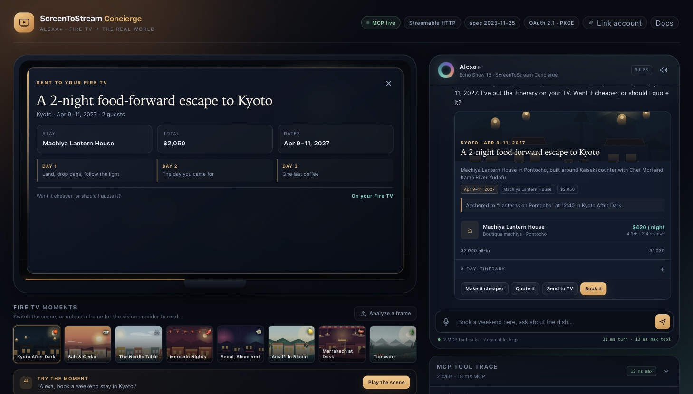
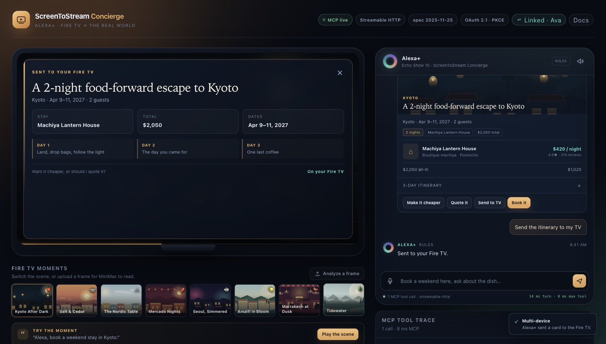
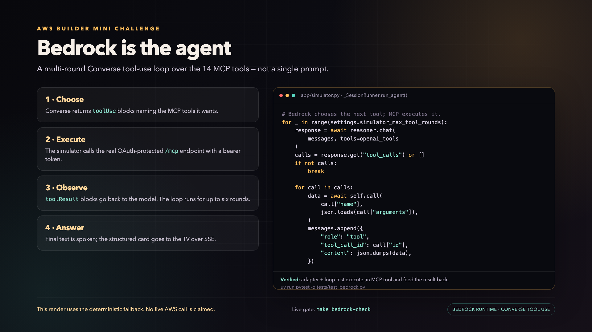

# Devpost submission draft

**Challenge:** Build, Ship, Shape: Amazon Developer Hackathon  
**Deadline:** **October 23, 2026, 12:00 PM PDT**  
**Primary track:** Alexa+  
**Mini challenges:** AWS Builder; Open Source (separate schema repository)<br>
**Repository:** <https://github.com/svarma143-ctrl/screentostream-concierge>  
**Local demo renders:** `demo/screentostream-concierge-demo-andrew-agentic.mp4`
(Andrew voice, updated agentic AWS segment) — **1:28**, 1080p, English neural
voiceover, soft captions. Preserved alternates:
`demo/screentostream-concierge-demo.mp4` (Ava voice) and
`demo/screentostream-concierge-demo-andrew.mp4` (Andrew voice, previous AWS
segment).<br>
**Public video URL:** _TBD — upload the updated Andrew render to YouTube/Vimeo before submitting_

> **Open Source mini challenge:** public repository at
> <https://github.com/svarma143-ctrl/screentostream-video-timeline>. It is a
> separate, additional contribution; the primary Alexa+ repository is not being
> double-counted.

## Challenge facts checked on 2026-10-22

- The Alexa+ track accepts a **self-hosted MCP server** speaking MCP
  **2025-11-25+** over **Streamable HTTP**, or an **Agent Skill**. A simulated
  Alexa+ experience built with your own agentic tools is also allowed.
- The Alexa+ resources link the open Agent Skills and Streamable HTTP docs. They
  do **not** require Alexa+ Preview console access for the self-hosted path.
- The **AWS Builder** mini challenge accepts documented AWS integrations. Our
  integration is Amazon Bedrock Runtime through `boto3`, with a Bedrock
  Converse tool-use loop that orchestrates the 14 MCP tools.
- Alexa+ already offers native travel planning and is adding booking partners
  such as Expedia and eDreams ODIGEO. We position ScreenToStream as a reference
  MCP add-on for the content-to-transaction seam, not as a replacement for
  those travel agents.
- The **Open Source** mini challenge requires a **new, additional** open-source
  project or a contribution to a public repository during the hackathon window.
  We created a separate `screentostream-video-timeline` schema repository; the
  primary Alexa+ repo is not being double-counted.
- The challenge resources page says **AWS credit codes are exhausted as of
  October 7, 2026**, and it is no longer accepting credit requests. Do not wait
  for a challenge code; use AWS Free Tier or an existing account.
- The demo video must be **under 3 minutes**, public on YouTube/Vimeo, in
  English, and free of third-party music/trademarks.

---

## Project name

**ScreenToStream Concierge**

## Tagline

**Turn the Fire TV moment you are watching into a real-world weekend — then book it.**

## Short description

ScreenToStream Concierge is a self-hosted Alexa+ MCP server and browser
simulator that turns a Fire TV viewing moment into a bookable travel and
culinary trip. The guest says “book a weekend stay here next spring”; the
server resolves the scene, builds a two-night itinerary, refines it, quotes it,
books it, and sends the itinerary card back to the TV.

The repository includes the real MCP server, the OAuth 2.1 + PKCE flow, 14
tools, SQLite persistence, an SSE TV overlay, and a browser client that is an
actual MCP client rather than a mocked chat surface.

### Media to upload

1. **Simulator overview** — the TV moment, Alexa+ conversation, live tool trace,
   and OAuth state in one surface.

   

2. **TV overlay** — the itinerary card returned by the real `send_to_tv` MCP
   tool over SSE.

   

3. **AWS agentic loop** — the Bedrock Converse tool-use loop used for the AWS
   Builder mini challenge.

   

---

## About the project

### Inspiration

Travel intent usually starts with a blank search box. It is much stronger when
it starts with something the guest is already emotionally engaged with: the
show they are watching, the dish on screen, or the city in the scene.

Fire TV gives Alexa+ a rich context signal. We wanted to prove that the TV
moment can become the start of a real-world plan without forcing the guest to
open another app or repeat the context.

### What it does

A guest is watching *Kyoto After Dark*. They say:

> “Alexa, book a weekend stay here next spring.”

Alexa+ calls the Concierge MCP server. The server:

1. Resolves the active viewing context (show, scene, destination, dish).
2. Builds a typed `TravelIntent` with dates, guests, budget, and style.
3. Selects a two-night stay, two experiences, dinners, and a day-by-day plan.
4. Returns a spoken summary plus a structured display card.
5. Supports refinements such as “cheaper, more food-focused.”
6. Creates a held quote and a simulated booking after confirmation.
7. Sends the itinerary card back to the Fire TV pane over SSE.
8. Exports a calendar file.

If the TV is off, the same server switches to standalone concierge mode and
plans from a destination and a sentence.

### Potential impact

The useful moment is not a blank search box; it is the moment a guest is already
engaged with a show. The target guest is in the living room, already has Alexa+,
and has just seen a place they want to go. The friction is not discovery; it is
the handoff from inspiration to a concrete plan. Fire TV reaches that moment at
home, and Alexa+ is already the voice surface in the room. If that context
becomes a typed, permissioned request, the guest can act without opening another
app or retyping a destination. The same pattern extends beyond travel: a scene,
a product, a recipe, or a ticket can become a structured, auditable transaction.

For this hackathon, the credible near-term case is a travel add-on: high-intent
discovery from content, deterministic pricing and availability, a held quote, a
simulated booking, and a card back on the TV. In the seeded demo, one sentence
produces a two-night Kyoto machiya stay, two experiences, two dinners, a
day-by-day plan, a held quote, and a confirmation—without retyping the
destination. The inventory is simulated, but the MCP contract, OAuth flow, and
transaction state machine are real.

### Design

The simulator puts the TV moment, the Alexa+ conversation, the OAuth state, the
live MCP tool trace, and the returned TV card on one screen. The same surface is
the demo, the protocol inspector, and the product walkthrough. That is
deliberate: judges can see the real request path instead of a mocked chat UI.

### Relationship to Alexa+ native travel planning

Alexa+ already supports trip planning and is adding booking partners such as
Expedia and eDreams ODIGEO. We are not claiming to invent conversational travel
or to replace those agents.

ScreenToStream is a reference Alexa+ MCP add-on for a different seam: it starts
from the Fire TV moment the guest is already watching, turns that context into a
typed `TravelIntent`, and carries it through a deterministic quote, a simulated
booking, a TV card over SSE, and a calendar export. The travel inventory is
simulated. The contribution is the context-to-transaction bridge and a working,
inspectable implementation of the MCP/OAuth contract.

It is also not a classic Alexa skill in the Skills store; it is a self-hosted
MCP server designed for the Alexa+ MCP add-on path. See Amazon's [Alexa+ Travel
Planning help](https://www.amazon.com/gp/help/customer/display.html?nodeId=TnoUUverxu5bfPUs7l)
and the [Alexa+ MCP Toolkit overview](https://developer.amazon.com/docs/alexaplus/add-ons/mcp-toolkit-overview.html).

### How we built it

- **Alexa+ / MCP:** FastAPI + FastMCP, Streamable HTTP at `/mcp`, protocol
  `2025-11-25`, session IDs, JSON and SSE responses.
- **OAuth:** authorization code + PKCE S256, protected-resource metadata,
  authorization-server metadata, the `resource` parameter, bearer JWTs, refresh
  rotation, and the Alexa+ bare-`401` behavior.
- **Tools:** 14 MCP tools covering viewing context, catalog, planning,
  refinement, quotes, bookings, profile preferences, TV handoff, and calendar
  export.
- **Simulator:** a simulated Fire TV pane, a simulated Echo Show conversation,
  a live tool trace, eight switchable scenes, frame upload, voice output, and an
  SSE TV overlay. It authenticates with a real bearer token and calls the real
  `/mcp` endpoint. This is a browser simulator, not a Fire TV app.
- **AWS:** Amazon Bedrock Runtime through `boto3`; Converse for structured
  intent, narrative, refinement, vision, and a multi-round agentic tool loop;
  InvokeModel for Nova Canvas or Titan hero art. The model chooses an MCP tool,
  the simulator executes it through `/mcp`, and the result drives the next
  Converse turn.
- **Fallback:** deterministic catalog, pricing, planning, and rules routing when
  no cloud provider is configured. The demo works without credentials.
- **Storage:** SQLite for viewing sessions, trips, quotes, bookings,
  preferences, usage, and OAuth state.

### Challenges

- Alexa+ expects a **bare `401` without `WWW-Authenticate`**, while common
  FastAPI security helpers add that header automatically.
- OAuth discovery has several host-coupled values: `resource`, issuer, redirect
  URI, and token audience. A tunnel hostname change invalidates all of them.
- The MCP version-skew between a raw `initialize` and a client default is easy
  to misread.
- Voice latency must stay off the model path. We kept catalog, dates, pricing,
  and quote math deterministic, with background narrative and speculative
  caching.
- Bedrock model IDs and inference profiles are not portable across regions and
  accounts.
- `boto3` is synchronous, so the async server wraps it with `asyncio.to_thread`.

### Accomplishments

- A working, self-hosted MCP server with 14 tools, OAuth 2.1, PKCE, SSE, and
  SQLite persistence.
- A browser simulator that exercises the real protocol rather than a fake REST
  route.
- A complete plan → refine → quote → book → TV-card → calendar flow.
- A Bedrock adapter with mocked-runtime tests, a loop-level test that executes
  an MCP tool and feeds the result back to Converse, and a separate live
  readiness gate.
- A credential-free path that judges can run immediately.
- A public repo with CI, Docker verification, a friction log, and an
  architecture blueprint.

### What we learned

The TV moment is a better intent signal than a blank chat box, but the MCP
onboarding contract needs better feedback. The biggest paper cuts were the bare
`401`, host-coupled OAuth values, model-access portability, and the lack of a
standard “what is on TV right now” context shape.

### What’s next

- Real Fire TV frame/event ingestion with a signed device payload.
- A named tunnel or stable hosted deployment so OAuth onboarding is one-time.
- Live Bedrock verification with per-provider latency and cost.
- A reusable Alexa+ MCP conformance CLI.
- A standard companion-screen card instead of an app-specific SSE payload.

---

## Built with

`Python` `FastAPI` `FastMCP` `MCP` `OAuth 2.1` `PKCE` `SQLite` `SSE` `JavaScript`
`HTML` `CSS` `Amazon Bedrock` `boto3` `Claude` `Titan Image Generator`
`Nova Canvas` `Docker` `GitHub Actions` `Cloudflare Tunnel`

---

## Try it out

### Fastest path — no credentials

```bash
git clone https://github.com/svarma143-ctrl/screentostream-concierge.git
cd screentostream-concierge
cp .env.example .env
uv sync --all-groups
uv run uvicorn app.main:app --host 127.0.0.1 --port 8000
```

Open <http://127.0.0.1:8000>, click **Play the scene**, and try:

1. “Book a weekend stay here next spring.”
2. “Make it cheaper and more food-focused.”
3. “Quote it.”
4. “Book it.”

The provider badges say **fallback** when no cloud provider is configured. This
is deliberate: the demo is fully usable offline.

### Verify the protocol contract

With the server running:

```bash
make smoke
make smoke-full   # or: uv run python scripts/smoke.py --full
make check
```

`make smoke` performs discovery, PKCE, token exchange, MCP initialization, tool
listing, and a tool call over the real HTTP endpoint.

### Docker

```bash
cp .env.example .env
docker compose up --build
```

### Judge testing notes

- **Fast judge path:** run `make demo`, open `http://127.0.0.1:8000`, and click
  **Play the scene**. No account, API key, or email is required.
- `DEMO_MODE=true` and sample data are enabled by default. The OAuth **Link
  account** button is optional; it demonstrates the real PKCE consent flow with
  the seeded `demo-user` account, but the product flow works without linking.
- No private credentials are required for the deterministic path.
- The submission-path rationale, optional Alexa+ console steps, and evidence
  checklist are in [`docs/ALEXA_PLUS_ONBOARDING.md`](ALEXA_PLUS_ONBOARDING.md).
- The MCP endpoint is `http://127.0.0.1:8000/mcp`.
- The OAuth client used by the simulator is `screentostream-simulator`.
- The Alexa+ client ID is `alexa-plus-client`.
- A public tunnel is optional for judging; it is required only for a real
  Alexa+ client that cannot reach localhost.
- Bedrock is optional. The adapter, agentic loop, and mocked tests are in the
  repo; live AWS requires the reviewer's own credentials and model access.

---

## AWS Builder mini challenge

**AWS service:** Amazon Bedrock Runtime through `boto3`.

- **Agentic tool loop:** Bedrock Converse returns `toolUse` blocks; the
  simulator executes the selected MCP tool through the real OAuth-protected
  `/mcp` endpoint; the `toolResult` is appended and the model decides the next
  step for up to six rounds.
- **Converse API:** structured intent, narrative, refinement, and the agentic
  tool loop, using `global.anthropic.claude-sonnet-4-6` by default.
- **Multimodal Converse:** frame understanding with Claude image blocks.
- **InvokeModel:** Nova Canvas (default, native 16:9) or Titan hero art.
- **IAM:** documented least-privilege policy and first-use Marketplace
  permissions.
- **Readiness gate:** `make bedrock-check` makes one real Converse call and
  fails explicitly if credentials, region, model access, or IAM are wrong.
- **Fallback:** deterministic rules and catalog path when AWS is not configured.

Full operator guide: [`docs/AWS_BEDROCK.md`](AWS_BEDROCK.md).  
Agentic loop design and evidence: [`docs/AWS_AGENTIC_LOOP.md`](AWS_AGENTIC_LOOP.md).

From-zero AWS account guide: [`docs/AWS_ACCOUNT_SETUP.md`](AWS_ACCOUNT_SETUP.md).

> **Honest status:** the Bedrock adapter, the mocked loop-level test, and the
> live gate are complete. Live AWS validation is pending an AWS account and
> model access. The public demo uses the deterministic fallback and says so.
> This is a single-service Bedrock integration with an agentic loop; it does
> not claim AgentCore, Strands, or a deployed AWS runtime.

---

## Open Source mini challenge

- **Contribution:** Video-to-Geospatial Timeline Schema
- **Repository:** <https://github.com/svarma143-ctrl/screentostream-video-timeline>
- **Contribution URL:** the same repository (new project)
- **GitHub username:** `svarma143-ctrl`
- **CI:** [GitHub Actions run](https://github.com/svarma143-ctrl/screentostream-video-timeline/actions/runs/39776675496) — passing
- **License:** MIT

**What I did:** I created a standalone, MIT-licensed JSON Schema 2020-12
contract for “shoppable/bookable video.” It maps time ranges in a video to a
scene, a geospatial place, supporting evidence, confidence, and optional
bookable catalog references. The repository includes two examples, a Python
validator with semantic checks, nine tests, CI, and a short integration guide
for MCP tool results. It was extracted from the working ScreenToStream Concierge
reference implementation during the hackathon window, but it is a separate,
reusable project rather than a copy of the primary app.

**How it works:** A content pipeline or MCP tool emits a timeline document with
`media`, `timeline[]`, `place`, `scene`, `evidence`, and optional `bookable`
entries. The validator enforces time ordering, non-overlap, media duration,
confidence ranges, coordinate bounds, and core-field hygiene. The schema keeps
observations separate from offers: `catalog_ref` is a stable reference, while
price and availability remain hints that a transactional system must confirm.
`extensions` carries vendor-specific data without polluting the portable core.

**Why it matters:** Video is a rich intent signal, but most metadata formats
stop at describing the media. This contract gives builders a portable way to
carry the moment on screen into an MCP tool, a planning flow, or a booking
handoff without inventing a new payload for every content partner. It is
domain-neutral, so the same shape can support travel, retail, food, or live
events.

---

## Product feedback

### Alexa+ MCP

**What worked:** once the contract was clear, the core loop was clean. Viewing
context, planning, quote, booking, and “send to TV” map naturally onto MCP.
Tool descriptions are the real API for voice.

**What needs work:**

- The bare `401` requirement conflicts with common FastAPI security helpers and
  with generic RFC 9728 discovery.
- OAuth discovery failures are invisible. `invalid_target` does not explain
  whether the problem is the host, trailing slash, resource, or redirect URI.
- Protocol-version negotiation needs one unambiguous answer in the toolkit.
- There is no standard media-context shape for “what is on TV right now.”
- Voice needs per-tool latency budgets and a supported long-running-tool
  pattern.
- A reference MCP client and conformance CLI would shorten onboarding
  dramatically.

**Onboarding:** the first successful OAuth + MCP call felt excellent. The path
there was mostly host-coupled configuration and header-policy debugging.

**Would we build again?** Yes. The tool abstraction is a good fit for voice, and
the TV context is a strong differentiator.

### Amazon Bedrock

**What worked:** the Converse API is a clean abstraction for text, vision, and
tool use. The tool-use loop is a good fit for MCP: the model chooses a tool, the
MCP client executes it, and the result goes back as a `toolResult`. `boto3` is
familiar, and the Nova/Titan image path is straightforward once the request
shapes are normalized.

**What needs work:** model IDs and inference profiles are not portable across
regions/accounts; the current default is a global profile, but accounts differ;
first-use model activation is opaque; `boto3` is synchronous; and the failure
modes for IAM versus model access versus region look similar. A “test this
model” button and a copyable inference-profile ID would remove most first-run
failures. A canonical OpenAI-style ↔ Converse tool-use translation example would
also save every MCP builder the same adapter work.

**Onboarding:** mocked tests were easy; live access was the hard part because it
depends on account activation, model access, Marketplace permissions, and the
exact model ID.

**Would we build again?** Yes, with a stable model-access checklist and a live
readiness gate from day one.

Full feedback: [`docs/PRODUCT_FEEDBACK.md`](PRODUCT_FEEDBACK.md).

---

## Feature requests

1. **Alexa+ MCP conformance CLI** — discovery, PKCE, bare `401`, session ID,
   protocol version, SSE, and latency checks. Priority: **Critical**.
2. **Standard media-context contract** — active title, position, device,
   freshness, optional frame, and TV-off state. Priority: **Important**.
3. **Per-tool latency budgets and long-running-tool semantics** — so voice can
   narrate work without inventing filler. Priority: **Important**.
4. **Bedrock model-access diagnostics** — distinguish region, model access,
   Marketplace subscription, IAM, and inference-profile errors. Priority:
   **Important**.
5. **Reference web MCP client** — raw handshake, SSE frames, replayable tool
   calls, and header diagnostics. Priority: **Nice-to-have**.

---

## Friction log

The guided friction log is in
[`docs/FRICTION_LOG_V2.md`](FRICTION_LOG_V2.md). It follows the Trag.dev
friction-log structure: BLUF and grade, persona, scoped checklist, pros/cons,
severity-ranked friction points, questions, prioritized recommendations, test
environment, and success/failure evidence. The detailed engineering log remains
in [`docs/FRICTION_LOG.md`](FRICTION_LOG.md).

---

## New vs. existing project

**New project.** The public repository and all source code were created during
the hackathon submission window. No pre-existing production project is being
submitted. The separate
[Video-to-Geospatial Timeline Schema](https://github.com/svarma143-ctrl/screentostream-video-timeline)
repository is also new and was created during the same window.

---

## Submission checklist

- [x] Public GitHub repository
- [x] MIT license visible on GitHub
- [x] Setup and run instructions
- [x] Working MCP server at `/mcp`
- [x] 14 tools and OAuth 2.1 + PKCE
- [x] Browser simulator that calls the real MCP endpoint
- [x] AWS Builder integration documented
- [x] Product feedback
- [x] Friction log
- [x] CI and Docker verification
- [x] Separate Open Source schema repository published with passing CI
- [x] Demo video recorded — updated Andrew agentic cut is 1:28, well under the 3:00 limit
- [ ] Demo video published publicly on YouTube/Vimeo
- [ ] Devpost text description pasted in
- [ ] Track and mini challenge selected
- [ ] Final submission clicked before **Oct 23, 12:00 PM PDT**

---

## Demo video

The updated submission cut is
`demo/screentostream-concierge-demo-andrew-agentic.mp4` (Andrew voice, 1:28,
1920×1080, H.264/AAC, English neural voiceover, soft English captions). Its AWS
segment shows the Bedrock Converse tool-use loop, a passing adapter/loop test,
the live gate, and an explicit deterministic-fallback disclaimer. It does
**not** fake a live AWS call.

The previous Ava and Andrew renders remain in `demo/` as alternates. Upload the
updated Andrew MP4 to YouTube or Vimeo, set visibility to **Public**, then paste
the URL into this document and the Devpost form. The caption file is
`demo/screentostream-concierge-demo-agentic.srt`.

See [`docs/DEMO_SCRIPT.md`](DEMO_SCRIPT.md) for the shot list and narration.
